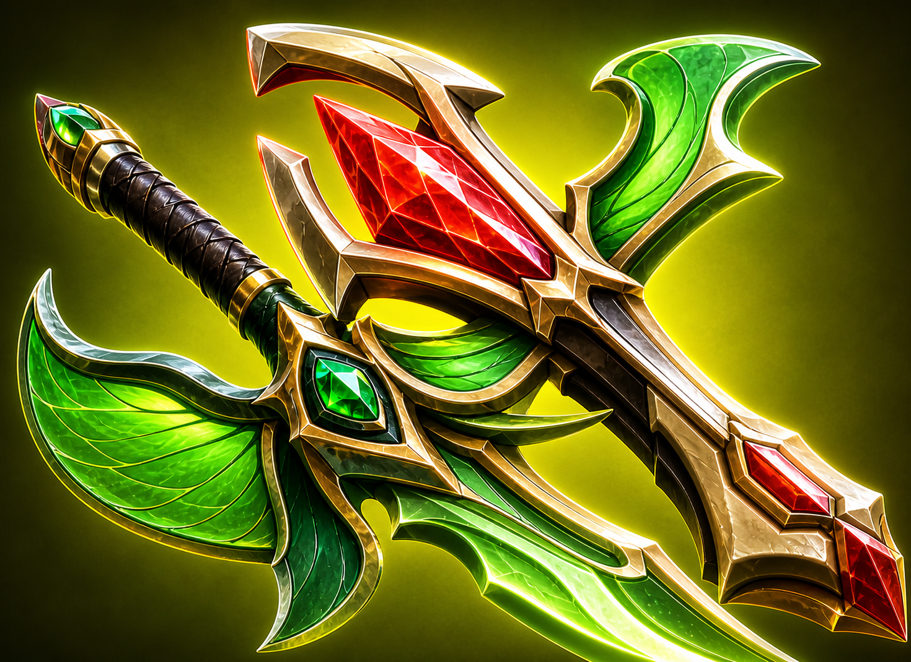
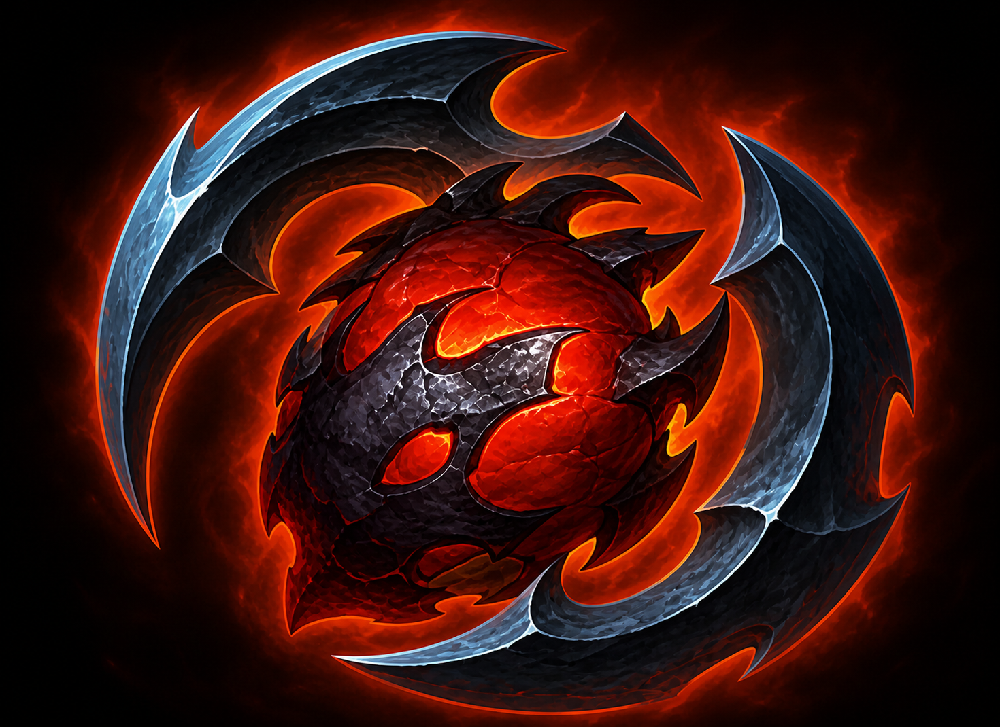
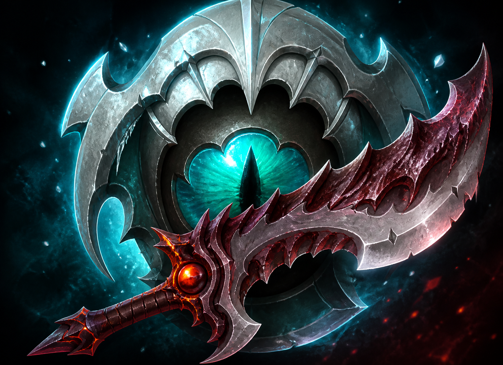
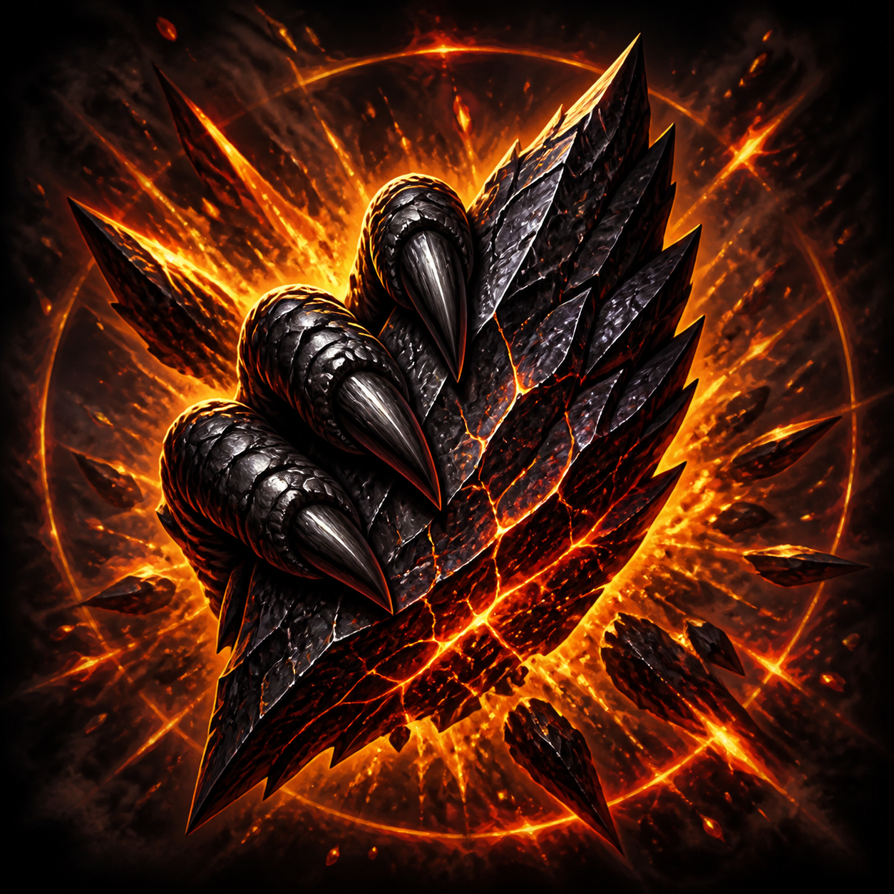

# Overforged · 超限武装

让装备突破上限：融合终局神装，吸收永久能力，打造属于自己的超限武装。

面向 Dota 2 本地模组使用，采用 VPK 打包与部署。当前包含 **42 个装备条目**（含达贡不同等级入口），覆盖永久吸收、装备融合与独立升级。

[融合与永久吸收](#融合与永久吸收) · [升级装备速览](#升级装备速览) · [打包与使用](#打包与使用)

## 融合与永久吸收

永久吸收类装备在符合条件的英雄装备栏内自动吸收，释放物品格；次数限制和保留属性见各条目。价格为成品配置标价，替代合成路线的实际材料花费可能不同。

### 真视宝石·永恒

**价格：1700 金**

- **合成：** 真视宝石 + 配方（800 金）。
- **效果：** **自动吸收。** 合成后进入存活英雄的装备栏时自动吸收，无需主动使用。永久使全地图所有敌方英雄和敌方单位处于己方队伍的真视侦测下，并使吸收者获得高空视野，不再占用物品格。
- 每支队伍只能吸收一次。重复合成的物品不会被消耗，也不叠加真视；可出售。幻象、克隆体和信使不能吸收。
- 吸收者获得高空视野，但不会获得飞行移动，也不能看见战争迷雾中的敌人。不保留原宝石的主动现形技能；储藏处内不吸收。

### 玲珑心·精粹

**价格：8175 金**

- **合成：** 玲珑心 + 以太透镜 + 裂隙之石 + 配方（100 金）。
- **效果：** **自动吸收。** 本体英雄主装备栏内自动消耗，永久获得450生命值、450魔法值、80%冷却缩减、600施法距离、400作用范围和20魔法恢复，并使自身限时增益及对敌人施加的限时负面效果持续时间增加100%。不占物品格，死亡后保留。每名英雄只能吸收一次，重复物品保留。

### 三元重戟·升级

**价格：11301 金**

- **合成：** 慧光 + 散华 + 夜叉 + 金箍棒 + 配方（1 金）；也支持用对应双剑替代其中两把单剑。
- **效果：** 由散华、夜叉、慧光和金箍棒一起合成。 **纯粹打击。** 攻击不会落空，并且每次攻击额外造成100点纯粹伤害。攻击距离加成可以与其他装备以及多件本装备叠加。
- **属性：** 力量 100；敏捷 100；智力 200；状态抗性（%） 80；攻击速度 100；移动速度加成（%） 33；生命恢复及吸血增强（%） 100；魔法恢复增强（%） 100；技能增强（%） 100；每次攻击额外纯粹伤害 100；可叠加攻击距离 200；施法速度加成（%） 50；魔法消耗及损失降低（%） 75；减速抗性（%） 100。

### 蝶翼之殇



**价格：10551 金**

- **合成：** 蝴蝶 + 代达罗斯之殇 + 配方（1 金）。
- **效果：** 由蝴蝶和代达罗斯之殇融合而成。 **必然致命一击。** 对非建筑单位的每次攻击都有100%几率造成300%伤害，并提供85%闪避。
- 致命一击对建筑无效。
- 与其他闪避效果为非线性叠加。
- **属性：** 敏捷 100；攻击速度加成（%） 30；攻击力加成 100 + 50；基础攻击间隔 1.2 秒；闪避 85%；暴击概率 100%，伤害倍率 300%。

### 不洁魔心



**价格：10251 金**

- **合成：** 撒旦之邪力 + 恐鳌之心 + 配方（1 金）。
- **效果：** 由撒旦之邪力与恐鳌之心融合而成。 **不洁狂热。** 吸血效果提升至175%，持续6.0秒。 驱散类型：弱驱散 **吸血。** 攻击者每次攻击都将根据造成伤害的一定百分比回复生命值。 **巨兽之血。** 生命恢复提升缺失生命值的1.5%。
- 多个巨兽之血的效果不会叠加。
- 多个吸血效果不会叠加。
- **属性：** 力量 +75；攻击力 +25；攻击吸血 30%；每秒恢复最大生命值的 2% 和缺失生命值的 1.5%；主动冷却 5 秒。

### 无间神镜盾

**价格：8651 金**

- **合成：** 林肯法球 + 清莲宝珠 + 配方（1 金）。
- **效果：** 由林肯法球和清莲宝珠融合而成。进入存活英雄的主装备栏后自动吸收，不再占用物品格，也不保留两件材料的属性。 **无间回音坚盾。** 抵挡并反弹大多数指向性技能给施法者。此效果没有冷却时间。
- 无法触发原版法术抵挡或法术反弹的技能仍不会触发本效果。

### 深渊冰眼



**价格：12151 金**

- **合成：** 深渊之刃 + 斯嘉蒂之眼 + 配方（1 金）。
- **效果：** 由深渊之刃与斯嘉蒂之眼融合而成。 **强击。** 击晕一个敌方目标，持续1.6秒。 无视减益免疫。 **重击。** 近战和远程英雄攻击时均有25%的概率击晕目标1.2秒，并额外造成120点物理伤害。 **霜冻攻击。** 攻击对敌方近战目标减缓25%移动速度，对敌方远程目标减缓50%移动速度；同时降低25攻击速度和50%生命恢复，持续3.0秒。
- 重击不会与其他重击效果叠加。
- 霜冻攻击不会与其他斯嘉蒂之眼的减速效果叠加。
- **属性：** 攻击力 105；减速抗性（%） 100；生命恢复及吸血增强（%） 20；全属性 100。

### 龙息溅射



**价格：4000 金**

- **合成：** 狂战斧或行家阵列，搭配配方（100 金）。
- **效果：** 由狂战斧或行家阵列与升级卷轴融合而成。进入存活英雄的主装备栏后自动吸收，不再占用物品格。 **龙息溅射。** 攻击会对目标周围500范围内的敌人造成100%攻击伤害。远程和近战英雄均可触发。 提供50点攻击力、10点生命恢复和5点魔法恢复。

### 怪蛇之息·升级

**价格：6900 金**

- **合成：** 怪蛇之息 + 配方（1000 金）。
- **效果：** **自动吸收。** 合成后进入存活本体英雄的主装备栏时自动吸收，不再占用物品格。永久增加800攻击距离。 **多重攻击。** 每次远程攻击时，对周围攻击距离+150范围内最多10个其他可见敌人各发出一次普通攻击，可触发攻击特效。
- 每名英雄只能吸收一次，重复合成的成品保留且可出售。幻象、克隆体和信使不能吸收；储藏处内不吸收。
- 吸收效果死亡后保留。攻击距离可与其他装备叠加；多重攻击仅在远程攻击时生效。

### 霜阳神铠

**价格：9201 金**

- **合成：** （辉耀 + 希瓦的守护）、辉耀·升级或希瓦的守护·升级，任选一路搭配配方（1 金）。
- **效果：** 融合辉耀与希瓦的守护，同时保留两件原升级物品作为替代组件。 **恒燃辉耀。** 灼烧始终开启，每秒对敌军造成160点魔法伤害。幻象每秒造成100点伤害。作用范围：1200。 **霜冷光环。** 使1200范围内敌人的攻击速度降低140。
- 辉耀灼烧永久开启，无法关闭。
- 该融合物品没有主动技能。
- 多个辉耀灼烧或霜冷光环效果不会叠加。
- **属性：** 攻击力 100；每秒灼烧伤害 160；幻象每秒灼烧伤害 100；闪避（%） 90；光环范围 1200；护甲 50；作用范围加成 400；敌方光环攻击速度 -140。

## 升级装备速览

直接列出升级后的主要属性与技能数值，价格单位为金。达贡数值依次对应 1–5 级；其 5 级独立入口合并展示。

| 装备 | 价格 | 升级版数值 |
| --- | ---: | --- |
| 以太透镜·升级 | 3275 | 魔法值 +300；回蓝 +2.5/秒；施法距离 +800 |
| 绝刃·升级 | 6600 | 生命 +450；魔法 +450；全属性 +8；回血 +7/秒；回蓝 +38/秒；法术强化额外伤害 250；减速 50%，持续 8 秒；冷却 4 秒 |
| 秘奥闪光·升级 | 7800 | 智力 +200；闪烁距离 1400；回复生命 250、魔法 300；受伤禁用 0 秒；冷却 5 秒 |
| 强袭胸甲·升级 | 6125 | 攻速 +130；护甲 +60；1200 范围光环：友军攻速 +50、护甲 +15，敌军护甲 -15 |
| 血棘·升级 | 7400 | 智力 +50；攻速 +195；攻击力 +20；回蓝 +13/秒；回血 +15/秒；冷却 7 秒 |
| 达贡之神力·升级（1–5 级） | 1 级 4000；5 级 8400 | 全属性 +6/7/8/9/100；伤害 400/500/600/700/1800；施法距离加成 +60/90/120/150/580；冷却 27/24/21/18/5 秒 |
| 黯灭·升级 | 4500 | 攻击力 +55；减甲 16，持续 17 秒；每次击杀 +10、助攻 +5 攻击力；成长上限 3000 |
| 圣斧·升级 | 6075 | 智力 +100；攻速 +100；护甲 +28；回蓝 +10/秒；弹道速度 700；智力伤害系数 1；减速 50%，持续 12 秒；主动魔抗降低 100%；被动冷却 12 秒；主动冷却 0 秒 |
| 散魂剑·升级 | 7100 | 敏捷 +100；智力 +100；每次攻击燃烧魔法 100；敌我主动效果均持续 10 秒；移速增益变化速率 5；耗蓝 5；冷却 5 秒 |
| 永世法衣·升级 | 4900 | 力量 +10；生命 +250；魔抗 40%；伤害转化魔法比例 50%；每层额外魔抗 3.5%，最多 6 层 |
| 虚灵之刃·升级 | 6200 | 全属性各 +50；虚灵伤害为 50 + 3 倍属性；冷却 10 秒 |
| 缚灵索·升级 | 5650 | 生命 +450；魔法 +200；智力 +100；作用范围 +375；耗蓝 50；冷却 6 秒 |
| gunpowder_gauntlets·升级 | 1000 | 攻击力 +10；溅射范围 500；溅射伤害 100%；冷却 0 秒 |
| 鱼叉·升级 | 5700 | 攻击力 +125；力量 +75；敏捷 +75；智力 +100；回蓝 +10/秒；施法距离 1700；牵引比例 70%，最大距离 2000；被动冷却 2 秒；耗蓝 25；主动冷却 9 秒 |
| 飓风长戟·升级 | 5450 | 智力 +55；敏捷 +60；力量 +55；生命 +200；攻击距离 +750；推送距离 1600；对敌距离 450；攻击效果持续 16 秒、最多 15 次攻击；耗蓝 10；冷却 10 秒 |
| 清莲宝珠·升级 | 4850 | 护甲 +10；回血 +6.5/秒；魔法 +250；回蓝 +4/秒；回音之壳持续 3600 秒；耗蓝 25；冷却 5 秒 |
| 幻影斧·升级 | 5650 | 全属性各 +100；攻速 +30；移速 +25%；2 个幻象，持续 18 秒；近战/远程幻象输出 33%/28%，承受伤害 300% |
| 雷神之锤·升级 | 6500 | 攻击力 +25；攻速 +180；静电护盾持续 360 秒，100% 触发、伤害 525；连环闪电 100% 触发、伤害 380；耗蓝 5；冷却 5 秒 |
| 银月之晶·升级 | 5000 | 持有：攻速 +140、夜间视野 +400；吞噬：永久攻速 +200、夜间视野 +1000 |
| 否决坠饰·升级 | 5350 | 攻击力 +75；护甲 +10；回血 +6/秒；否决持续 20 秒；弹道速度 4800 |
| 盛势闪光·升级 | 7800 | 力量 +85；闪烁距离 1200；受伤禁用 0 秒；冷却 7 秒 |
| 辉耀·升级 | 5700 | 攻击力 +100；闪避 25%；灼烧范围 850；每秒伤害 160，幻象每秒伤害 100 |
| 圣剑·升级 | 6600 | 基础攻击力 +500；切换获得额外攻击力 +550 或技能增强 +100%；死亡掉落 |
| 英灵胸针·升级 | 4300 | 攻击力 +135；技能吸血 34%；幻影暴击概率 45%，额外魔法伤害为攻击伤害的 150% |
| 奶酪块·升级 | 1002 | 护盾 1000；恢复等待 0 秒；效果持续 50 秒 |
| 邪恶镰刀·升级 | 6200 | 智力 +150；回蓝 +18/秒；妖术 5 秒；施法距离 1800；耗蓝 50；冷却 10 秒 |
| 希瓦的守护·升级 | 5500 | 护甲 +50；作用范围 +400；1200 范围光环降低攻速 140；极寒冲击伤害 260，减速持续 10 秒，半径 1200，扩张速度 600 |
| 白银之锋·升级 | 6700 | 攻击力 +140；攻速 +90；力量 +30；智力 +30；回蓝 +10/秒；隐身 60 秒、移速 +25%；破坏持续 16 秒；冷却 10 秒 |
| 林肯法球·升级 | 5800 | 全属性 +56；回血 +15/秒；回蓝 +10/秒；被动法术抵挡冷却 5 秒；主动冷却 7 秒 |
| 迅疾闪光·升级 | 7800 | 敏捷 +85；闪烁距离 1200；主动移速 +40%、敏捷 +35，持续 6 秒；受伤禁用 0 秒；冷却 7 秒 |
| 风之杖·升级 | 7800 | 移速 +60；回蓝 +10/秒；智力 +200；龙卷风持续 2.5 秒；耗蓝 25；冷却 7 秒 |

> 数值依据当前装备配置与中文文本整理。永久吸收、叠加和特定技能交互以游戏实际表现为准。

## 打包与使用

需要 Python 3.10+、PowerShell 5.1/7 与 VPKEdit CLI。在仓库根目录执行：

```powershell
# 仅打包装备资源
.\deploy_items_only.ps1 -PackageOnly

# 游戏完全退出后，备份并部署到已配置的 dota_lv 目录
.\deploy_items_only.ps1
```

详细流程见 [VPK 打包与部署](docs/vpk-packaging.md)。部署脚本会检查游戏进程、备份旧包并校验哈希。

也可以使用 [GitHub Actions 打包与发布](docs/vpk-ci.md)：手动运行时默认发布测试版，直接下载 `pak02_dir.vpk` 即可试用；取消发布选项则只生成 Artifact。测试通过后给同一提交打版本标签，自动发布已测试的包。首版 `v0.1.0` 使用本 README 作为发布说明。

## 项目资源

- [装备展示网站与预览说明](website/README.md)
- [装备与配方配置](game/dota_addons/overforged/scripts/npc/npc_items_custom.txt)
- [中文装备说明](game/dota_addons/overforged/resource/addon_schinese.txt)
- [专属图标原图](artwork/item-icons)
- [物品开发记录](docs/dota2-custom-items.md)

现有 `game/dota_addons/overforged` 与 `content/dota_addons/overforged` 目录继续作为源码与资源目录；项目展示与使用说明以本地 VPK 模组为主。
